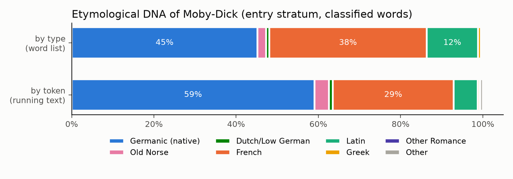
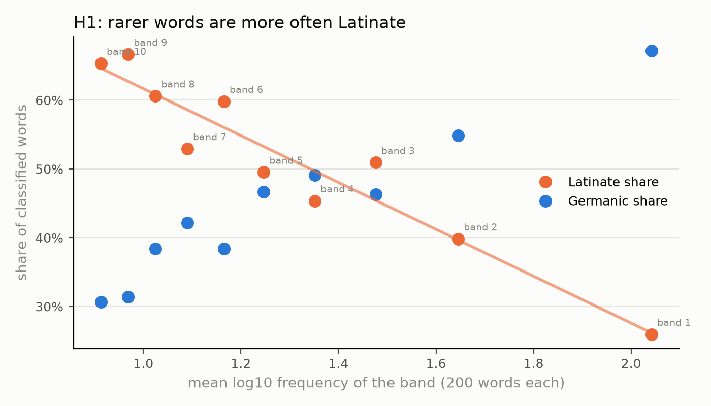
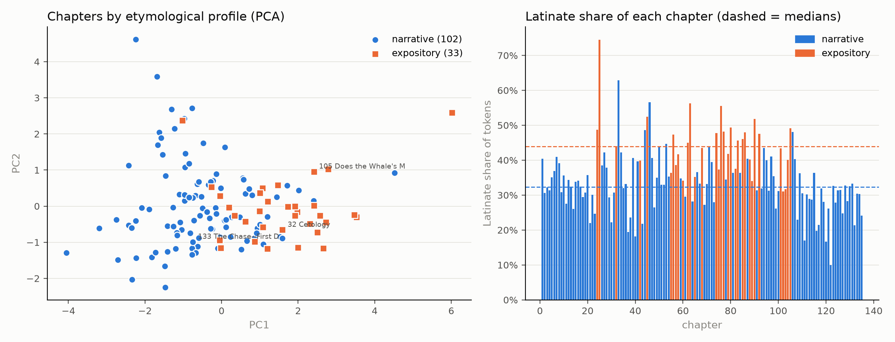
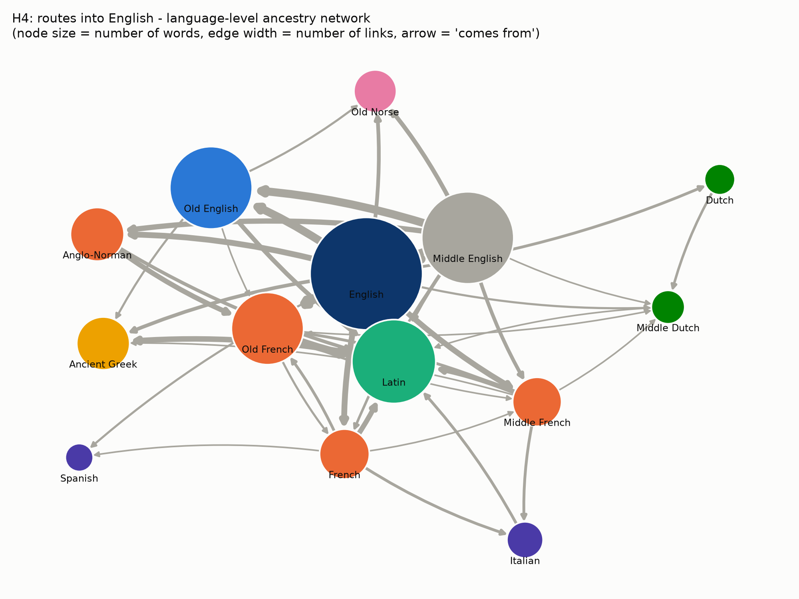

# The Etymological DNA of *Moby-Dick*
### A crawler-based study of word origins in Herman Melville's vocabulary

Final project for **Linguistic Data: Quantitative Analysis and Visualisation** (instructor: Daria Popova).
Student: Hasnain Saleem & Hassan Sibtain.

**The complete study (hypotheses, method, results, conclusions) is in [`Etymological_DNA_of_Moby_Dick.ipynb`](Etymological_DNA_of_Moby_Dick.ipynb).**

## What the project does

A **web crawler** traces the 2,000 most frequent content words of *Moby-Dick* through Wiktionary, page by page, back to their oldest recorded ancestor (*harpoon* → French *harpon* → Old French *harper* → Frankish *\*harpā*). The resulting etymological database is used to test five hypotheses about the layers of Melville's vocabulary:

| | Hypothesis | Result |
|---|---|---|
| H1 | Frequent words are Germanic, rarer words Latinate | **supported**: Latinate share rises from 26% (most frequent words) to ~65% (least frequent), R² = 0.91 |
| H2 | Expository "whale-science" chapters are more Latinate | **supported**: median 44% vs. 32%, Mann–Whitney p < 10⁻⁹ |
| H3 | Maritime vocabulary has more seafaring (Norse/Dutch) loans | **partly supported**: 10% vs. 2.5%, Fisher p = 0.013, but only borderline within nouns (p ≈ 0.06); maritime words are robustly *more Germanic* |
| H4 | *(exploratory)* Ancestry network: communities = language families, Old French/Latin as bridges | **partly supported**: Old French is the main bridge; NMI 0.53 but modularity 0.27 |
| POS | *(added after feedback)* Is origin related to part of speech? | no significant POS effect (χ² p = 0.79), but used as a control for H3 |
| H5 | Origin is predictable from spelling, less from meaning | **supported**: macro-F1 0.49 (spelling) vs. 0.36 (word2vec) vs. 0.16 (baseline) |






## Tools (one from each part of the course)

| Area | Tools |
|---|---|
| Data collection and formats | headless-browser crawler (Playwright, the maintained equivalent of pyppeteer) + `requests` fallback, wikitext parsing, JSONL, **SQLite**, pandas |
| Parsing | spaCy lemmatization and POS tagging, regular expressions |
| Vectorization | TF-IDF (chapters; character n-grams), word2vec (gensim) |
| Machine learning | linear regression, logistic-regression classifier, k-means, hierarchical clustering, PCA, cross-validation |
| Graphs and visualisation | networkx (centrality, greedy-modularity communities), matplotlib |

## Repository structure

```
Etymological_DNA_of_Moby_Dick.ipynb   the study (executed, with all outputs)
CODE_EXPLAINED.md                     how the code works, file by file and step by step
crawler/
  wiktionary_crawler.py   the crawler: opens a word's page, scrapes the etymology, follows the ancestor link, ...
  wikitext.py             parsing of Wiktionary sections and etymology templates ({{inh}}, {{bor}}, {{der}}, ...)
  languages.py            language codes -> names -> etymological strata; chain classification
  etymwn_fallback.py      offline fallback: the same chains from the Wiktionary-derived Etymological WordNet
tests/
  test_crawler.py         offline tests of parsing and page-to-page crawling on sample Wiktionary pages
  test_fetchers_local.py  end-to-end test of both backends (headless Chromium, requests) against a local server
data/
  moby_dick.txt           the novel (Project Gutenberg, via the NLTK Gutenberg corpus)
  gutenberg/              18 Gutenberg books used to train word2vec
  wordlist.csv            the 2,000 traced words (Step 1)
  nautical_glossary.txt   maritime word set for H3
  manual_check.csv        60 words classified by hand to measure accuracy
  etymology.sqlite        the etymological database (tables words, links)
  crawl/ or etymwn/       crawled / fallback ancestry chains (JSONL)
figures/                  all figures
```

## How to run

```bash
pip install -r requirements.txt
python -m playwright install chromium        # once, for the headless-browser backend

# 1. run the tests (offline)
python -m tests.test_crawler
python -m tests.test_fetchers_local

# 2. crawl Wiktionary (about 1-2 hours for 2,000 words; can be interrupted and resumed)
python -m crawler.wiktionary_crawler --wordlist data/wordlist.csv --out data/crawl/etymologies.jsonl
#    lighter alternative:            add  --backend requests
#    quick try with 20 words:        add  --limit 20

# 3. run the notebook (uses the crawl if it covers the word list, otherwise the offline fallback)
jupyter nbconvert --to notebook --execute --inplace Etymological_DNA_of_Moby_Dick.ipynb
```

The crawler reads raw wikitext from the article path (`/wiki/<title>?action=raw`), which `robots.txt` allows. It checks `robots.txt` before starting, waits 1 second between requests, sends a descriptive User-Agent and caches every page in `data/crawl/cache/`.

**Data source of the included run.** The notebook prints which source it used. If the crawl output is missing, it falls back to the Etymological WordNet (de Melo 2014), which was itself extracted from Wiktionary (via the `ety` package). Running step 2 above and then re-running the notebook replaces the data with a fresh crawl.
